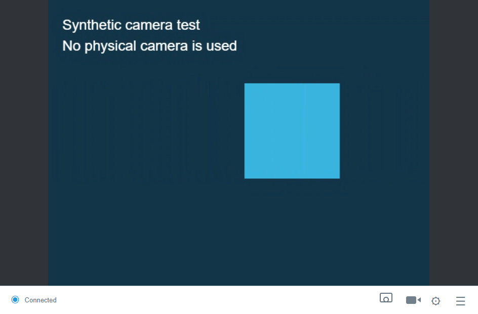
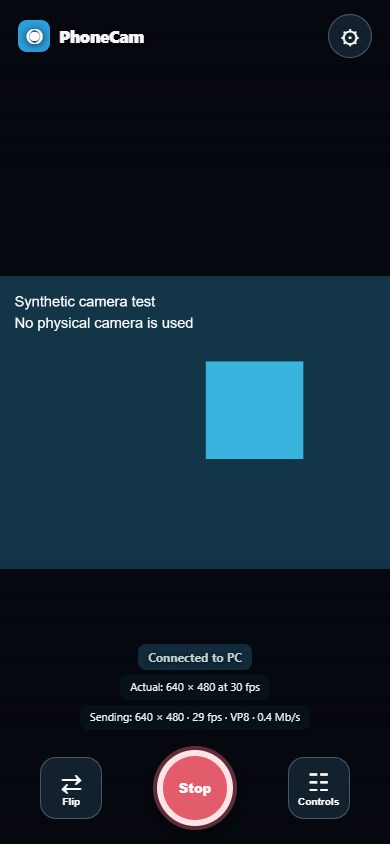
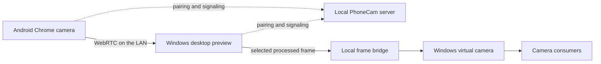

# PhoneCam — Open-source Android webcam for Windows

[](https://github.com/jaltareyr/phonecam/actions/workflows/ci.yml)
[](LICENSE)
[](docs/TESTING.md)
[](docs/GETTING_STARTED.md)

**Use your Android phone as a Windows webcam over Wi-Fi or USB.** PhoneCam
streams camera video directly across your local network using WebRTC, shows
a live Windows preview, and includes a native Windows virtual camera.

The phone runs the camera page in Chrome. No Android APK is required. The
desktop app is built with Electron, JavaScript, and a C++ Media Foundation
camera source. The project welcomes bug reports, device tests, and pull requests.

> **Public alpha:** phone-to-PC video has worked on the development Android/Windows
> setup. Zoom and Google Meet compatibility fixes are implemented but still need
> live device verification. Long-call reliability and installation on a second PC
> remain unverified. Downloads are unsigned. See the [test matrix](docs/TESTING.md)
> before relying on PhoneCam for a call.

**[Download alpha builds](https://github.com/jaltareyr/phonecam/releases)** ·
**[Connect your phone](docs/GETTING_STARTED.md)** ·
**[Contribute](CONTRIBUTING.md)** ·
**[Report a bug](https://github.com/jaltareyr/phonecam/issues/new/choose)**

Desktop and phone views below use a synthetic test feed; no personal camera footage is shown.





## What works today

- Android camera streaming over local Wi-Fi, with QR pairing and HTTPS.
- USB streaming through Android Debug Bridge (`adb reverse`).
- A Windows desktop preview and a native **1280 × 720 at 30 fps** virtual camera.
- A large phone preview with settings, Start/Stop, and front/rear camera switching.
- Phone resolution requests from 480p to 4K; actual modes depend on the device.
- Rotation, mirroring, color adjustments, whole-frame effects, and image overlays.
- Snapshots, video recording, a separate feed window, and feed-only fullscreen.
- Camera controls such as zoom, focus, exposure, and flashlight where Android Chrome exposes them.
- Desktop approval for new phone connections and automatic signaling reconnection.

The phone's **Actual** and **Sending** lines report capture and encoded video
dimensions. A 4K phone capture does **not** make the current Windows virtual
camera output 4K; that output is fixed at 720p/30.

## Install and connect

You need **Windows 11 x64, build 22000 or later**, an Android phone with Chrome,
and either the same trusted local network or a USB connection with ADB.

1. Download `PhoneCam-Setup-<version>-x64.exe` from
   [Releases](https://github.com/jaltareyr/phonecam/releases), compare its SHA-256
   with `SHA256SUMS.txt`, and run the installer. Administrator approval registers
   the Windows camera. Unsigned alpha builds may show a Windows publisher warning.
2. Open PhoneCam. Click the connection indicator at the bottom left and select **Wi-Fi**.
3. On first Wi-Fi setup, install **this PC's generated local CA certificate** on
   Android as described in the [connection guide](docs/GETTING_STARTED.md#wifi).
   Chrome needs a trusted connection to use the camera. Scan the QR code and
   allow camera permission on the phone.
4. Tap **Start** on the phone, then **Accept phone** in the Windows app. Approve
   only a connection you initiated. The preview should appear on the PC.
5. Keep PhoneCam open and select **PhoneCam** in your camera application's device
   selector. Call-app compatibility is still being validated.

The **portable EXE** runs the preview without installing the app. It does not
register or update the virtual camera. Use the installer for Windows camera
integration. USB setup is documented in the [connection guide](docs/GETTING_STARTED.md#usb).

## Current limits

| Area | Status |
| --- | --- |
| Android-to-Windows Wi-Fi and USB preview | Verified on the development setup |
| Windows virtual camera | Registered and captured through Media Foundation on the development PC |
| Zoom, Meet, Teams, and OBS | End-to-end compatibility testing still needed |
| 30-minute calls, reconnects, and second-PC installation | Validation still needed |
| Windows camera output | One device, fixed 720p/30; NV12 and RGB32 |
| Phone microphone | Optional audio stream and desktop playback; no selectable Windows virtual microphone |
| Multiple phones | Separate pairing rooms and previews; one selected Windows camera output |
| AI background removal and replacement | Planned; current blur/mosaic affect the whole frame |
| Native Android and iOS apps | Planned; current supported phone path is Android Chrome |
| Automatic discovery | PC advertises mDNS; browser pairing uses QR/code |

See the [roadmap](docs/ROADMAP.md) for priorities. Features described as planned
are not included in the alpha.

## Run from source

Install **Node.js 22.12 or later**; Node 24 LTS is recommended.

```sh
git clone https://github.com/jaltareyr/phonecam.git
cd phonecam
npm ci
npm start
```

Open `http://localhost:8080/viewer` on the PC. The server starts a loopback-only
HTTP listener on port 8080 and a LAN HTTPS listener on port 8443. Certificates
are generated locally into the ignored `certs/` directory.

For the Electron desktop preview:

```sh
npm run desktop
```

Browser preview development does not install a Windows camera. Building the
installer also needs Visual Studio C++ Build Tools, a Windows SDK, and Inno
Setup. See [development and builds](docs/DEVELOPMENT.md).

## How video gets to Windows



WebRTC negotiates the actual codec; PhoneCam currently prefers H.264 when
available. The local server handles pairing and signaling, not media relay.
There is no PhoneCam cloud account or hosted media service. Recording saves
files only when the user starts a recording or snapshot.

## Help build PhoneCam

**Pull requests are welcome.** You can contribute without owning every test
device: improve documentation, fix reproducible bugs, report device results,
or work on an issue marked `good first issue` or `help wanted`.

1. Read [CONTRIBUTING.md](CONTRIBUTING.md) and the [community guidelines](CODE_OF_CONDUCT.md).
2. For a large change, open an issue describing the problem and approach.
3. Fork the repository, make a focused branch, and run:

   ```sh
   npm run check
   npm test
   ```

4. Open a pull request describing the behavior, tests, and device limitations.

Useful areas include camera-consumer compatibility, Windows installation tests,
Android camera controls, reconnection, accessibility, and native mobile clients.
For security issues, use [private vulnerability reporting](SECURITY.md), not a
public issue containing exploit details or private video.

## Frequently asked questions

**Is PhoneCam an open-source alternative to iVCam?**
It aims to cover the phone-as-webcam use case with independent code, assets,
and protocol. It is not affiliated with E2ESOFT and does not yet have iVCam's
feature coverage or reliability validation.

**Can I use my phone as a webcam without installing an Android app?**
Yes. The current phone client runs in Android Chrome. Wi-Fi requires trusting
the certificate generated by your own PC; USB uses ADB reverse forwarding.

**Does the camera feed leave my local network?**
PhoneCam configures peer connections without external STUN or TURN servers.
Camera media flows between the phone and PC. Keep this alpha on trusted networks
and do not expose its listener through router port forwarding.

**Why can I select 4K but get a 720p webcam?**
Capture, transport, desktop preview, and virtual-camera output are separate
stages. Higher phone capture modes can be requested, but the current Windows
camera source outputs 1280 × 720 at 30 fps.

**Why is the video dark in a call app?**
First confirm that the PhoneCam desktop preview has live video and the call app
selected PhoneCam. Install the newest alpha and restart the camera consumer
after upgrading. Background frame scheduling, native write-contention, and RGB-stride fixes are included, but
call-app compatibility still needs verification. Please submit a
[device test report](https://github.com/jaltareyr/phonecam/issues/new/choose)
with Windows/app versions and logs that contain no private media or pairing codes.

## License and credits

PhoneCam is released under the [MIT license](LICENSE). The native camera source
derives from Microsoft's Windows-Camera sample. See
[third-party notices](THIRD_PARTY_NOTICES.md) for attribution and distribution
requirements. [Changelog](CHANGELOG.md) · [Security model](docs/SECURITY_MODEL.md)
